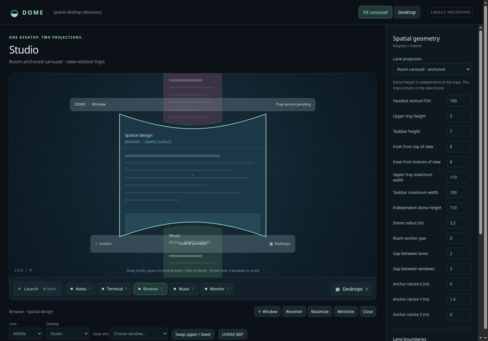

> This experimental branch defaults to FLTK 1.4.5. See [FLTK_EXPERIMENT.md](FLTK_EXPERIMENT.md) for build instructions and missing features.

# DomeD

An experimental Wayland compositor with a classic stacking desktop and a shared
spatial desktop model, based on the supplied three-lane dome design. This is an
independent repository; it does not modify or depend on WiVRn-Pro.

**The native application is Rust.** Godot is restricted to experiments under
`prototypes/` and is not a production compositor dependency. Both the desktop WM
and the OpenXR frontend are Rust. This experimental branch defaults to a cached
Cairo/FreeType shell adapter and OpenGL FLTK picker; Qt6 remains selectable.
See [the experiment report](FLTK_EXPERIMENT.md) for current validation and gaps.

**Current milestone:** a standalone DRM/KMS Wayland compositor with toolkit-rendered decorations, a classic
Mac-style global menu and a native Rust/OpenXR frontend displaying live Wayland
window textures, open cylindrical dome surfaces, curved pulled-out panels and
shared XR shell bars. Application identity/actions use XDG desktop entries; the
status area hosts StatusNotifier items and DBusMenu menus. Focused applications
can export their real menu bars through KDE AppMenu and DBusMenu. WiVRn marker
localization remains future work.



The optional [DomeD Translator](docs/TRANSLATOR.md) provides a native FLTK tray
translator for configured input languages, using DeepL API Free and local script
transcription. Build it with `scripts/build-translator.sh`.

## Build and toolkit selection

FLTK is the default Cargo feature. Native compositor builds require the patched
FLTK 1.4.5 installation, Cairo, FreeType, Fontconfig, GIO and PipeWire development
files, in addition to the Rust/Wayland/DRM dependencies below. Set its prefix
before using the local build script (the prefix must contain `include/` and `lib/`):

```sh
export DOME_FLTK_PREFIX=/path/to/patched-fltk-1.4.5
./scripts/build-local.sh --release
```

Qt6 is an explicit alternative, built separately so Cargo does not enable both
shell adapters:

```sh
cargo build --locked --release --no-default-features \
  --features nested,standalone,xr,qt6
```

Only this alternative needs Qt6 Widgets development files. The standalone
`dome-preview` layout service does not build a native shell and needs neither
FLTK nor Qt. See [the FLTK notes](FLTK_EXPERIMENT.md) for toolkit patches and
current limitations. Qt-based third-party applications and KDE portal services
remain separate runtime dependencies where used.

## Native tray applications and rendering audit

DomeD starts one native FLTK/OpenGL tray applications manager. Its single tray
entry opens a menu for tray applications, KDE Connect, Fcitx5 and KWallet in a
shared window. Closing the window keeps the tray entry running.
Other StatusNotifier applications keep native tray menus; X11 windows translated
by the session-owned bridge start on the desktop side. See
[tray controls and build instructions](docs/TRAY_FRONTENDS.md) and the
[workspace FLTK/GPU audit](docs/FLTK_GPU_AUDIT.md) for implemented paths,
remaining feature gaps and actual hardware evidence.

## Native administrator authentication

DomeD uses `dome-askpass`, a FLTK Pinentry frontend, as the default
`SUDO_ASKPASS` for its child applications and activated services. It uses the
shared patched FLTK 1.4.5 toolkit, Dome appearance settings and Ctrl+W/Escape
cancellation. Enter authenticates; Tab moves between controls. This configures
sudo's `-A` graphical password request; Polkit services keep their existing agent.
An explicitly supplied `SUDO_ASKPASS`, including an empty value, is preserved.

Build as your regular user before staging or installing DomeD:

```sh
python3 scripts/build-askpass.py --fltk-prefix /opt/fltk-vr/toolkit
scripts/stage-askpass.sh build/askpass-stage
python3 tests/askpass/test_dialog.py
```

The build verifies the pinned Pinentry 1.3.3 source checksum. The source archive,
patch, shared appearance header and GPL license accompany the installed helper
under `/usr/local/share/doc/domed/pinentry`. The frontend also retains standard
Pinentry Assuan operation. Passwords go directly to sudo through its output pipe;
cancellation returns failure without password output. No password file or cache
is created. Installation does not restart a desktop session.

## Try the layout laboratory

With a Rust toolchain installed:

```sh
cargo run --locked --bin dome-preview
```

Open **http://127.0.0.1:49640**. No headset, GPU development libraries, JavaScript
packages or network assets are required. The preview starts with sample windows.

* Switch **XR carousel / Desktop** to see the same window identities in both views.
* Use the room dome for an anchored cylindrical layout. Legacy **In view**
  profiles migrate to the dome; Ghostty XR owns its independent direct-view overlay.
* Set projection height and bar heights; bars automatically sit within 8 logical
  pixels of their adjacent lanes, with automatic centering and headset-fit widths.
* Drag empty space to simulate looking around. **Unfold 360°** exposes the whole ring.
* Select windows to minimize/maximize, recenter, move between lanes/desktops or swap.
* **Launch** at left searches apps; layout mode adds a sample window instead of
  launching. **Desktops** at right switches, creates, renames and removes workspaces.
* Hover task groups to expand their window list. Wheel over sample surfaces to
  demonstrate scroll targeting while leaving keyboard focus unchanged.

Geometry edits are session-local. **Export geometry JSON** saves a reusable
profile. To start with that profile:

```sh
DOME_CONFIG=/path/to/dome.json cargo run --locked --bin dome-preview
```

`DOME_PREVIEW_PORT` overrides the default loopback port. Use the displayed numeric
loopback URL; the development API intentionally rejects foreign origins/hosts.

## Run real Wayland clients

DomeD prefers [FLTerm XR](docs/FLTERM.md) when installed; Ghostty XR remains
available through `DOME_TERMINAL_BACKEND=ghostty` and as the fallback. Both retain
an independent native XR overlay, input focus and positioning controls. In the XR input realm, **Super+T**
opens it or creates and selects a new tab in its existing overlay. In the desktop
realm, including while XR is suspended, it opens an independent Wayland terminal
without changing the XR terminal. **F12** hides the selected overlay and releases keyboard input back to
Dome. In XR, **F12** or **Super+F12** reopens the overlay without adding a tab;
**Super+T** still creates a new tab. **Super+F12** always shows or starts the
independent XR overlay, including in desktop mode and with
`DOME_TERMINAL_MODE=wayland`; it never creates a desktop window or another tab.
Bare F12 remains available to desktop applications. The overlay uses placement
20, above Dome's placement 10.

```sh
./scripts/build-local.sh
./scripts/run-local.sh
```

`DOME_TERMINAL` selects the executable (a path without arguments). The local
runner prefers the sibling FLTerm XR build or its installed binary, with
Ghostty XR as the fallback. `DOME_TERMINAL_BACKEND=flterm|ghostty` selects the
control protocol for custom executables; see [FLTerm integration](docs/FLTERM.md). `DOME_TERMINAL_MODE=wayland` explicitly selects the separate Wayland
terminal mode in the XR realm as well. Desktop launches always use Wayland.
`dome-compositor --terminal` requests an initial terminal; launching without
arguments leaves an empty desktop. `--command PROGRAM ARGS...` still launches a
custom client. The local runner forwards explicit arguments unchanged.

The local build includes `dome-compositor`, `dome-preview` and `dome-xr` and runs
the Rust tests. It uses the default FLTK shell and requires `DOME_FLTK_PREFIX`
as described above. For the optional Qt6 build, this workstation can extract
missing development headers under `.local-deps/root`; these are not required by
the default shell. To recreate that optional dependency setup:

```sh
./scripts/prepare-local-deps.sh
```

For an isolated integration check, with python-xlib and Pillow available:

```sh
python3 scripts/test-terminal.py
```

The test uses a private Xvfb display and D-Bus session, types through DomeD's real
Wayland seat into the shell, opens a second terminal with Super+T, captures a
client texture through the XR bridge and checks window management and cleanup.
Logs and `terminal.png` are saved in `artifacts/terminal/`. This verifies the XR
texture transport without a headset; headset appearance still needs visual testing.

Install a Rust toolchain, C linker, `pkg-config`, Wayland/EGL/GLES and xkbcommon
development packages. On Ubuntu/Debian the development packages are typically
`build-essential pkg-config libwayland-dev libegl1-mesa-dev libgles2-mesa-dev
libxkbcommon-dev libfontconfig1-dev libfreetype-dev libglib2.0-dev
libcairo2-dev libpipewire-0.3-dev libgbm-dev libdrm-dev libinput-dev libseat-dev`.
The default shell also requires the patched FLTK prefix above. Add `qt6-base-dev`
(Qt6 Widgets 6.4 or newer) only when building the explicit Qt6 alternative. Then run from an existing Wayland or X11 desktop:

```sh
cargo run --locked --features nested --bin dome-compositor -- --terminal
```

The compositor opens a nested desktop window and prints its **own Wayland socket**.
This invocation runs inside your current desktop. To use it from the login
screen, install the session described below. Additional clients can connect using that socket and the same `XDG_RUNTIME_DIR`:

```sh
WAYLAND_DISPLAY=wayland-N your-wayland-app
```

The native shell supports click-to-focus, native title-bar controls/dragging, client-initiated move/resize,
minimize/maximize/close, app launch (also Super+Shift+Space) and desktop switching/creation.
Its local web panel controls the same live window/workspace model; its geometry
preview still uses sample surface content. App launching requires `gio`, installed
`.desktop` files. Login sessions start an optional `xwayland-satellite` bridge
when installed alongside Xwayland, and export its `DISPLAY` for X11 apps such as Steam.
Set `DOME_START_XWAYLAND=0` to disable it. A bridge attached to another compositor
cannot serve the Dome session.
Close the nested compositor window to end the experiment. The initial protocol
handlers are adapted from Smithay's MIT-licensed Smallvil; see THIRD-PARTY.md.

## System installation and login session

```sh
./scripts/build-local.sh --release
./scripts/stage-install.sh
pkexec /usr/bin/bash "$PWD/scripts/install-system.sh"
```

The installer puts release binaries in `/usr/local/bin`, session helpers in
`/usr/local/libexec`, documentation in `/usr/local/share/doc/domed`, and the
**DomeD** login entry in `/usr/share/wayland-sessions/dome.desktop`. It leaves
Plasma and the current login running. Log out, select **DomeD** in SDDM's session
menu, then log in. Replaced files are backed up under `/var/backups/domed`;
`/usr/local/share/domed/install.sha256` records installed file checksums.

The login session launches **DomeD directly**. Its native backend owns DRM/KMS
scanout, GBM/EGL rendering, a libseat/logind seat and libinput keyboard/pointer
devices. No KWin, Weston or other host compositor is started. **Log Out** stops
Dome and its terminal/XR children and returns to the login screen.

Run `dome-compositor --backend drm` from an unused TTY, or select DomeD at login.
Use `--backend nested` for a development window in an existing desktop. Without
an explicit backend, a host DISPLAY/WAYLAND_DISPLAY selects nested mode; otherwise
DRM is selected. `--check-backend` reports compiled support without opening a seat.

The native backend defaults to one GPU and drives every connected output on it.
Multi-GPU support is available only in builds with the Cargo feature `multi-gpu`
(`scripts/build-local.sh --release --multi-gpu`). These builds enumerate the seat's GPUs,
with independent CRTC assignment, scanout buffers, damage and page-flip scheduling.
Displays form a horizontal extended desktop by default. Each monitor has its own
bars; windows, cursors and popups use global desktop coordinates, and maximization
reserves the containing monitor's bars. Unplugging a monitor recovers stranded
windows; reconnecting it restores scanout without restarting the session. GPUs can
also be added or removed while other outputs remain active. Each GPU has its own
GBM/EGL renderer; advertised DMA-BUF formats are supported by every initial GPU.
Single-GPU builds import client buffers only on the selected GPU and ignore other
GPUs during hotplug, while retaining monitor hotplug on the selected card.
To pin a single-GPU binary to the Arc A770 in this system, build with:

```sh
./scripts/build-local.sh --release --drm-device /dev/dri/by-path/pci-0000:03:00.0-card
```

The device path is embedded at compile time through `DOME_BUILD_DRM_DEVICE` and
takes precedence over runtime `DOME_DRM_DEVICE`. It cannot be combined with
`multi-gpu`. Without a build pin or runtime device selection, a single-GPU build
uses the seat's primary GPU. `--check-backend` reports both build settings.

Open **Displays & XR Configuration** (**Super+,**) to select each connector's
resolution/refresh, enable it, choose a primary display, or position it explicitly
(including negative coordinates). Automatic arrangement restores horizontal layout.
The X/Y position buttons cycle between negative resolution, zero, and positive
resolution, using the selected display's width for X and height for Y. Changing
resolution updates nonzero manual offsets to the new width or height.
Hold **Shift** while dragging either a client titlebar or a DomeD titlebar to tile
a window into halves at monitor edges or quarters at corners. A translucent preview
shows the destination; drop while holding Shift to apply it, or release Shift to
cancel tiling. Tiling reserves the target monitor's bars and decoration borders.
New windows open on the primary display. Connector preferences are saved with the
XR configuration in `$XDG_CONFIG_HOME/dome/xr.json`; PCI addresses distinguish ports
on different GPUs. `DOME_DRM_DEVICE=/dev/dri/cardN` restricts diagnostics to one GPU;
`DOME_DRM_CONNECTOR=DP-1` restricts connectors by their kernel connector name.
With no connected monitor, a virtual 1280×800 desktop keeps XR clients rendering.

XR configuration uses a fixed 1024×768 canvas, independent of monitor resolution.
Expanded configuration follows the selected projection, anchor, pane distance and
vertical view field rather than stretching into a bar. Rows retain readable height;
wheel scrolling, the scroll buttons, arrows, Page Up/Down and Home/End navigate
all options. The selected row stays visible and hit testing follows the viewport.

**Ctrl+Alt+F1…F12** switches VTs through libseat. Seat deactivation stops scanout and
input, balances held buttons/keys, stops XR input and hides the terminal overlay.
Reactivation restores scanout and client focus. Native Wayland clients can use
DMA-BUF buffers. DomeD owns the cursor globally: client cursor images, hotspots
and hide requests cannot replace or hide it. Native and nested sessions draw the
same DomeD arrow, with the nested host cursor hidden. Appearance changes repaint
the cursor immediately: light fill in dark mode, dark fill in light mode, with a
contrasting outline. The nested and native backends share shell, popup and XR rendering.

The session requests XR and the selected terminal at startup. If the headset
or runtime is unavailable, the desktop remains usable; use **Start XR** when it
becomes available. `DOME_START_XR=0` disables automatic XR startup and
`DOME_SESSION_TERMINAL=0` starts without a terminal. The saved XR layout at
`$XDG_CONFIG_HOME/dome/xr.json` is used. Session logs are in
`$XDG_STATE_HOME/dome/logs` (default `~/.local/state/dome/logs/latest.log`).
Run `dome-session --check` to verify installation dependencies.

Native logins save open applications and window placement in
`$XDG_STATE_HOME/dome/session.json` (normally `~/.local/state/dome/session.json`).
The next login reopens applications using their saved argument boundaries and
working directories, then restores workspaces, lane order/rotation, desktop
geometry and stacking, minimized/maximized state, and XR poses, scale, dome offsets and
pullout placement. XR presenters recreated later by their owning applications
retain their placement even when the headset starts after login. Transient
dialogs and popups are excluded; document recovery remains application-owned.
The file is private and written atomically, with background checkpoints and a
final save before logout, restart, shutdown or compositor termination.
`DOME_SESSION_RESTORE=0` disables both saving and restoring. Nested sessions leave
the saved login untouched unless explicitly enabled with `DOME_SESSION_RESTORE=1`.

For real KMS regression tests without using the current seat, prepare a private
VKMS card, then run the native tests. They exercise actual kernel page flips,
Wayland and EGL client pixels, seat pause/resume, held-button release, inactive
input suppression and clean exit. No physical input devices are opened.

```sh
pkexec /usr/bin/bash "$PWD/scripts/vkms-test-device.sh" prepare
uv run --no-project --with PySide6 --with pillow python scripts/test-native-drm.py
uv run --no-project --with PySide6 --with pillow python scripts/test-native-drm.py --installed
pkexec /usr/bin/bash "$PWD/scripts/vkms-test-device.sh" prepare-second-gpu
./scripts/build-local.sh --multi-gpu
uv run --no-project --with PySide6 --with pillow python scripts/test-native-drm.py --multi-gpu
pkexec /usr/bin/bash "$PWD/scripts/vkms-test-device.sh" cleanup
```

`DOME_DRM_TEST_DEVICE` and the comma-separated `DOME_DRM_TEST_DEVICES` accept only
the kernel's `vkms` driver.
Multiple test devices require a `multi-gpu` build; test devices bypass the build
device pin. The `DOME_DRM_TEST_CONTROL` socket is available only in that test mode. Production
sessions always use libseat and libinput. `DOME_DRM_CAPTURE` and `DOME_DRM_REPORT`
write diagnostic framebuffer snapshots and scanout counters when explicitly set.
`DOME_DRM_CAPTURE_ALL=1` names snapshots per output; `DOME_DRM_REPORT_ALL=1`
names reports per GPU. The native tests cover two heads, unplug/replug, negative
coordinates and a client moving between two virtual GPU devices.

## Compositor renderer

DomeD defaults to `--renderer vulkan` (`DOME_RENDERER=vulkan`). Smithay's GLES
renderer runs through [Mesa Zink](https://docs.mesa3d.org/drivers/zink.html), which
executes composition on Vulkan. This is a Vulkan-backed GLES implementation,
not a separate native Vulkan implementation of Smithay's renderer traits.
Mesa Zink and a Vulkan driver for the GPU are required. Startup logs the actual
renderer and rejects a Vulkan request if the driver is not Zink.

Native DRM composition renders to GBM scanout buffers. Nested mode uses an
independent Vulkan context for composition and copies the finished frame through
a GLES presentation context, so the host display need not provide Vulkan WSI.
The nested copy is intended for development; it is not a zero-copy path. Driver
selection is confined to compositor context creation and does not override the
renderers of launched applications. `--renderer gles` or `DOME_RENDERER=gles`
selects the previous GLES path. `DOME_RENDER_CAPTURE=/path/frame.ppm` enables
nested framebuffer readback for diagnostics.

The keyboard respects `[Keyboard] NumLock` in `kcminputrc`: `0` enables NumLock,
`1` disables it, and `2` (or an absent setting) preserves the existing kernel LED
state when available. NumLock and CapsLock survive keyboard layout changes, and native
keyboard LEDs follow NumLock/CapsLock/ScrollLock, including newly added devices.

## Clipboard, KWallet and KDE Connect

DomeD supports regular Wayland copy/paste, primary selection (middle-click paste),
and both `zwlr_data_control_manager_v1` and `ext_data_control_manager_v1` for
unfocused clipboard tools. Unicode text and arbitrary MIME bytes work. Clipboard
history/persistence requires a separate clipboard manager. KDE Connect's current
KSystemClipboard backend uses ext-data-control and is tested in both directions.

The native login session exports its ready Wayland display and Qt platform to D-Bus
before starting wallet integration and the installed KDE Polkit authentication
agent. This keeps administrative prompts available without Plasma autostart;
`DOME_START_POLKIT=0` disables agent startup. When a PAM wallet socket is supplied, DomeD
runs the installed `pam_kwallet_init` helper. Current KWallet's `ksecretd` starts
when no Secret Service provider already owns the session bus; KDE applications can
activate `kwalletd6` normally. The Dome-specific portal configuration selects
KWallet for the Secret portal and KDE’s Qt6 backend for common desktop dialogs,
with GTK as a fallback when a Qt6 implementation is unavailable. Existing wallet
settings and login-manager PAM configuration are preserved. Automatic unlocking
requires PAM login credentials; passwordless login can still require a wallet
password. The tests use a separate bus, HOME and encrypted disposable wallet and
verify the real password dialog, Secret Service write/read, and KWallet API.

Vivaldi launches (including desktop actions, PATH launches and session restore)
receive `XDG_CURRENT_DESKTOP=Dome:KDE` and `KDE_SESSION_VERSION=6` so Chromium
automatically selects the system's KWallet 6 backend without `--password-store`.
This compatibility environment is scoped to Vivaldi; the session and other apps
keep the Dome desktop identity. Dome remains first for portal selection. An
already running Vivaldi must be fully closed before relaunching to pick it up.

KDE Connect's indicator starts automatically at login when `kdeconnect-indicator`
is installed, after the session's Wayland display is ready. Set
`DOME_START_KDECONNECT=0` to disable this startup. Its daemon/CLI and graphical
interface can also run inside DomeD. DomeD does not yet run general XDG autostart
entries. Remote phone mouse/keyboard control is currently unavailable because DomeD
has no Remote Desktop portal backend. DomeD now supplies the notification server
and action buttons used by KDE Connect, including pairing requests. Device pairing,
network file transfers and phone-side operation require a real-device test. The
local audit starts KDE Connect in a private network namespace, so it never sends
pairing, discovery or payload packets to existing devices. File chooser support is
provided by the Qt6 KDE portal; SSHFS and PipeWire remain external dependencies.

To repeat the service checks (after preparing local Qt development dependencies):

```sh
scripts/build-service-fixtures.sh
uv run --no-project --with dbus-next --with python-xlib --with pillow python scripts/test-session-services.py
```

## Screen sharing and WayVR desktop capture

DomeD implements the ScreenCast v3 portal on its own session bus name,
`org.freedesktop.impl.portal.desktop.dome.screencast`. The installed
`dome-portals.conf` selects it explicitly; general dialogs default to Qt6/KDE.
The login publishes its ready display to D-Bus and systemd before starting
`dome-session.target`, which holds `graphical-session.target` as a dependency.
This also supports distributions which forbid starting the shared target directly.
Logout releases the Dome session target. A Qt6 portal service
override selects its native KDE platform theme to avoid startup recursion through
the application GTK appearance bridge. Portal service
units must inherit `XDG_CURRENT_DESKTOP=Dome` rather than forcing `KDE`.

WayVR and other portal clients can share one or several monitors after choosing
sources in the native sharing picker (FLTK by default). Each chosen monitor has its own PipeWire node and logical
position and size. Capture includes desktop windows, decorations and shell, with
hidden or embedded cursors. An active sharing tray indicator provides **Stop sharing**;
no permanent status window is opened. Its menu action, closing the portal session,
output removal or resize, and a frontend exit all revoke the capture.
Absolute desktop input uses the full monitor bounds, including negative origins,
so WayVR's desktop-wide coordinates line up with the selected monitor. Requests from
arbitrary D-Bus peers cannot bypass the frontend. Permissions are per session;
this first backend does not persist restore tokens or capture individual windows.
Remote Desktop, InputCapture, GlobalShortcuts and Screenshot are not advertised
through KDE's KWin-specific implementations.

The initial transport uses RGBA shared-memory buffers and GPU readback, capped
at 30 frames per second, only for monitors currently shared. It does not yet use
DMA-BUF zero-copy transport. Building requires `libpipewire-0.3` development files;
running requires PipeWire, a policy manager such as WirePlumber, the portal
frontend, and the installed `dome-portal-picker` next to the compositor. Install
the new compositor and log back into DomeD before using desktop capture.

The integration test uses a private D-Bus, Xvfb display, PipeWire graph and
WirePlumber policy profile. It checks the real frontend, consent/cancellation,
actual captured Wayland pixels, stream teardown and frontend access controls:

```sh
uv run --no-project --with dbus-next --with python-xlib --with pillow --with PySide6 python scripts/test-screencast.py
DOME_TEST_RENDERER=vulkan DOME_TEST_PORTAL_DEFAULTS=1 uv run --no-project --with dbus-next --with python-xlib --with pillow --with PySide6 python scripts/test-screencast.py
```

## Notifications and keyboard layouts

DomeD owns `org.freedesktop.Notifications` on its session bus when no other desktop
notification server is present. Standard Notify, replacement, CloseNotification,
GetCapabilities and GetServerInformation calls are supported. Desktop toasts and
a separate headset-facing XR pane share the same dismiss and action handling.
Notifications preserve keyboard focus. Timeouts emit the standard close reasons;
critical notices and zero-timeout notices stay until acknowledged. Default and
explicit actions emit ActionInvoked; resident actions keep their toast open.
Up to three toasts are displayed, with a bounded queue of 128 active notifications.
Body text is plain text; sound, image hints, markup, inline reply, and persistent
notification history are not advertised or implemented. Another desktop's existing
notification daemon is never replaced by a nested DomeD test.

Steam's `notificationtoasts_<number>_desktop` windows are captured when their
app ID is `steam` or `steamwebhelper`. Their rendered content enters the same
notification stack, desktop/XR toast surface and bounded image history as regular
D-Bus notifications. They do not occupy a task, desktop lane or saved app layout,
or take keyboard focus. Clicking the toast content forwards the click to Steam;
its close control dismisses the captured notice until Steam hides or reuses the
source window. Normal Steam windows and other applications are not intercepted.
Steam does not provide message text over this route, so history retains the
rendered notification image rather than inventing a text transcription.

The regression uses real X11 windows through the session's Xwayland satellite,
on private Xvfb and D-Bus instances, and checks captured pixels, focus, forwarded
clicks, dismissal, reuse, destruction and ordinary D-Bus notifications:

```sh
uv run --no-project --with python-xlib --with pillow python scripts/test-steam-notifications.py
```


US English, **Anthy** Japanese, Czech, Korean **Hangul**, and Serbian Cyrillic
input use the installed Fcitx5 framework. **Super+Space** cycles the available
methods; **Super+Shift+Space** opens the application launcher. The top-bar
flag and US/あ/CZ/한/СР label open the native Fcitx5 menu, with input-method,
group, and configuration submenus. There is one language indicator; Fcitx's
separate tray icon is suppressed. `fcitx5-configuration-fltk` opens the shared
FLTK configuration frontend and accepts `fcitx://config/...` targets.
The native login session starts Fcitx5 on a private, trusted Wayland
connection. Input-method-v2 and virtual-keyboard privileges are restricted to that
connection. Text-input-v3 clients receive Japanese preedit, conversion and commit;
candidate popups use the same desktop and spatial popup pipeline as application
popups and retain the text field's keyboard focus.

Fcitx5's Dome-specific configuration lives under `~/.config/dome/fcitx5/`, with
`keyboard-us` and `anthy` seeded when no Dome profile exists. Startup adds installed
`keyboard-cz`, `hangul` and `keyboard-rs` choices to the active Dome group while
preserving existing entries, order and layout overrides. Serbian uses the default
Cyrillic XKB layout; Hangul uses Korean syllable composition. Another session's
Fcitx5 instance and configuration are preserved. GTK applications use the Fcitx
module; Qt6 uses native Wayland text input. Applications need a compatible text
input protocol or toolkit module. Fcitx5, `fcitx5-anthy` and `fcitx5-hangul` supply
the complete set; unavailable engines are omitted from the switch cycle.
Nested tests start the framework only with `DOME_START_IME=1`; a normal nested
preview leaves the host input-method service alone.

Open **Dome menu → Keyboard Layouts…** to edit up to four comma-separated XKB
layout names, positional variants, options and switching shortcut. The panel also
selects whether the shortcut switches input methods or XKB layout groups.
Click a text field, use Ctrl+A to clear it, and Enter to apply or Esc to cancel.
Invalid keymaps leave the working configuration intact. Keyboard preferences and
the last XKB group save to `$XDG_CONFIG_HOME/dome/keyboard.json` (normally
`~/.config/dome/keyboard.json`). The panel uses the fitted view pane in XR.

```sh
uv run --no-project --with PySide6 --with python-xlib --with pillow python scripts/test-input-method.py
```

## Native Rust XR frontend

Start `dome-compositor` and connect native Wayland clients first. With an active
OpenXR runtime (Monado or a connected WiVRn headset) and Vulkan available:

```sh
cargo run --locked --features xr --bin dome-xr -- --server http://127.0.0.1:49640
```

Use the compositor's printed port if it differs. `XR_RUNTIME_JSON` selects the
runtime for this process. No runtime registration or service settings are changed.
The default XR background is transparent: Dome submits window/shell/popup layers
without a desktop background or opaque full-view layer. When `XR_EXTX_overlay` is
available, it creates an overlay session above the main XR application (placement
10 by default; override with `--placement N`). It prefers alpha environment
blending, then additive blending. This preserves the running application's scene
or runtime-provided passthrough behind the desktop. See the
[OpenXR overlay extension](https://registry.khronos.org/OpenXR/specs/1.1/html/xrspec.html#XR_EXTX_overlay).

Without overlay support, Dome can use a transparent primary session if the runtime
supports alpha/additive blending. Camera passthrough must be enabled through the
headset/runtime; Dome does not start camera capture. If only an opaque primary
session is possible, normal startup reports that transparency is unsupported.
Use `--standalone` explicitly for an isolated diagnostic/simulator session that
may have an opaque background. Startup logs and `--report` record the chosen
overlay and environment blend settings. Client windows and shell bars keep their
own content opacity; the XR environment between them stays clear.

`--frames 240 --report /tmp/dome-xr.json --capture /tmp/dome-textures` runs a finite
session and writes diagnostics and **client texture** PNGs. Those PNGs are not eye
captures. The integration test separately captures the simulated headset output.

In **room dome** mode, attached windows use open cylindrical OpenXR layers.
Only the horizontal direction curves; vertical texture spacing stays linear,
without convergence or a top/bottom cap. The upper lane leans inward by **8°**
for readability. Adjust **Upper dome inward lean** in XR settings (0–20°), or
set `dome_upper_tilt_deg` in the geometry profile; 0° gives a straight tube.
Ray-to-UV hits use the same cylinder and lean as rendering. Dome is the only
compositor XR projection; Ghostty XR retains its independent direct-view overlay. `XR_KHR_composition_layer_cylinder` is required for
the dome; a runtime lacking it gets an explicit error instead of a flat substitute.

Grip a dome window and pull inward by 18 cm, or press **Super+P**, to move it
into a front reading panel. There are exactly **two side-by-side slots** across
the session. The panels follow a shallow cylindrical arc at a default distance
of **2 m** (`pullout_distance_m`, configurable from 0.6–3 m). Each starts at
1.3 m of arc width and preserves the window's aspect ratio. The pair anchors in
the room at the user's position/yaw on the first pull, and stays there as the
user turns or moves their head. Mouse hits and cursor placement use the same
curved surface; a stationary mouse retains its panel UV through pullout,
return, scaling and head motion.

Press **Super+P** again to return the focused panel. **Return to Dome Layout** also restores its original dome
placement. The shortcut is configurable under Settings → keybindings; old
profiles gain it automatically unless Super+P is already assigned, in which
case the new action starts disabled. A third pull leaves that window on the
dome. Scaling grows panels outward from the central gap.

The same native menu/tray/taskbar is rendered into two XR shell layers,
with adjustable bar heights and automatic lane attachment. Menu and preview expansion
keeps the original top/bottom edges fixed. Mouse clicks invoke native shell
commands, including application actions, task previews and status menus. Horizontal
bar widths automatically fit the runtime field of view; no width or offset settings are needed.

Compatible Wayland window buffers travel through the private DMA-BUF bridge into
Vulkan swapchains without CPU pixel readback. `dome-xr --transport auto` falls back
to RGBA transport per window; `--transport cpu` forces compatibility transport and
`--transport gpu` requires GPU sharing. Shell images still use CPU rasterization
and upload. Diagnostic `--capture` uses CPU transport. The compositor thread owns
input and Wayland resource lifetimes; GPU sharing still renders into OpenXR
swapchains and does not guarantee dedicated VRAM placement.

Mouse and keyboard are the only input methods. The XR renderer requests no hand
or eye tracking extensions and emits no tracked input. The mouse cursor follows
the compositor's selected surface UV, including curved windows and captured drags.
Use **Super+P** to pull/return a panel and **Shift+Super+R** to reset its layout.
**Ctrl+Alt+Up/Down** focuses a central window in the previous/next populated dome
lane, wrapping around and skipping empty lanes. It leaves window placement unchanged.
**Alt+Tab / Alt+Shift+Tab** then cycles windows within the focused lane.
Lane navigation applies in XR and passes through while Ghostty has focus.
Move the focused window up/down a lane with **Super+Alt+Up/Down**. Lane moves
recenter the window; moving a pulled-out panel returns it to the dome.
**Super+Alt+Left/Right** reorders it horizontally within its lane, stopping at
both ends. **Super+Equals/Minus** grows/shrinks it by 10% within 0.25–4× scale.
The focused window renders over its neighbours; enlarged unfocused windows
render underneath them. The larger XR reticle follows the same Appearance palette
as the desktop cursor, with a contrasting outline over application content.
These actions can be rebound in Settings.
Saved profiles retire stock duplicate shortcuts while preserving custom remaps.

Inactive desktops with XR windows remain visible as progressively deeper, faded
dome layers behind the active desktop. Background layers do not accept mouse or
keyboard input; switching desktops brings the selected layer to the front.
Minimized windows and windows assigned only to the physical desktop are omitted.

### Spatial application popups

Wayland `xdg_popup` menus, nested menus and parented `xdg_toplevel` dialogs are
separate panels attached to their owning window. They do not take a lane slot.
Their placement follows the active projection:

* **Room dome:** a flat panel 14 cm forward and 4 cm above the parent's upper edge.
  A thin blue beam connects its lower edge to the origin on the parent surface.
  The beam is decorative and never captures mouse input.
* **Desktop:** popups open at the client-provided hierarchy anchor. Nested menus
  respect the requested edge flips when approaching the work-area boundary. A popup
  without an anchor opens 8 logical pixels below the cursor. DomeD announces the
  placement in the Wayland popup configure event so rendering, input and submenu
  navigation share coordinates. Placement stays within the shell bars.

Popup textures are captured separately from parent textures, and pointer UVs map
to the actual popup surface. Popups follow parent movement, scale, workspaces and
visibility. Protocol popup grabs support nested menus, Escape and outside-click
dismissal. Losing the owning window's focus or changing the input realm dismisses
grabbed menus. Dialogs retain their normal client keyboard behavior. Content drawn
inside a client's existing surface cannot be split into a spatial popup.

**Right-click context menus** use a shared placement and scrolling policy instead
of the general popup rules. Their bottom centre sits 8 logical pixels above the
RMB point. Direct-view menus layer 6 cm forward; dome menus layer 14 cm forward
and connect back to the exact click with a beam. Desktop placement clamps to the
work area, and XR placement fits between the view-relative shell bars. Context
menus receive keyboard focus as soon as they map, including clients that do not
request an explicit popup grab. Other application popups keep the rules above.

Menus taller than the work area have fixed top/bottom scroll controls with a
bounded content viewport. Click the arrows or use the mouse wheel to reach hidden
content. Scroll-control clicks stay inside DomeD; clicks in the menu body map back
to the correct client content coordinates after scrolling. The same viewport
logic handles DomeD task context menus, where Up/Down, Home/End and Page Up/Down
navigate or scroll, Enter activates the selected item, and Escape dismisses the
menu. Keyboard focus stays with the menu while it is open. Native application
menus continue to use their application's keyboard handling.

```sh
./scripts/build-local.sh
python3 scripts/test-popups.py
```

The isolated test requires PySide6, python-xlib, Pillow and Xvfb. It checks real Qt
Wayland menus/dialogs, nesting, side-panel and front-fallback desktop pixels,
separate XR textures, XR pointer coordinates, dismissal and cleanup. Captures and
protocol logs are saved in `artifacts/popups/`. Rust geometry tests cover both XR
projections, beam endpoints, matching ray hits, nested placement, parent scale and
visibility, and mouse input. Headset appearance still needs visual verification.
The test also checks RMB anchors in desktop and XR seat input, immediate context
focus, top/bottom scrolling, scrolled input coordinates and a task menu with fifty
desktop actions. Context screenshots are saved alongside the popup captures.

Rust and real Wayland-client tests cover mouse geometry and seat delivery.
Headset cursor appearance still needs visual verification. GPU buffer sharing and
persistent marker localization remain follow-up work.
The optional Godot viewer remains a separate design prototype.

## XR routing, cursor ownership and desktop session

XR surfaces contain client content without compositor titlebars or borders; the
focused window expands **4 logical pixels on each edge**, filling four pixels
of the adjacent gap. A 1 mm depth bias keeps raised edges in front. Global menus
own window commands. Applications that draw controls into their own client buffers
retain those controls. Menu-exporting applications provide their actual command
trees in the global bar; applications without an exported menu keep their controls
in their own windows.

Dome has two Wayland sockets, printed at startup. Desktop launches connect to the
normal socket and appear in both projections. Launches through the XR shell use
the XR socket and appear only in XR while its renderer is healthy. The desktop
taskbar filters those windows. Origin belongs to the Wayland connection, including
additional windows from that client. A single-instance application activated over
D-Bus can reuse its existing connection and therefore retains that connection's
origin.

OpenXR visibility and headset pose determine XR availability.
Stopping/interruption promotes XR-only windows to the primary desktop without
relaunching them. Missing renderer heartbeats recover them within two seconds,
including after SIGKILL. They are unminimized, moved to desktop 1, clamped to the
primary work area and stacked. They stay on desktop when XR resumes. Focus loss
while the session remains visible suspends XR cursor rendering without promoting windows.
The nested backend and the initial native DRM backend expose one primary output.

Physical mouse motion, button and wheel events control the XR pointer. Its position
persists while idle, with no timeout or switch to another input source. The cursor
follows the hit surface's curvature and lean; empty space keeps the cursor anchored to the full dome cylinder.
Head and carousel movement preserve its surface UV while it remains visible.
The cursor stops inside the headset viewport edges, including after head movement.
Held buttons capture the
original target through a drag. Outside XR, the mouse uses desktop stacking.

In dome mode the upper menu/tray bar sits at most **8 Wayland logical pixels**
above the rendered top lane, and the taskbar sits at most 8 logical pixels below
the rendered bottom lane. Both share the lane cylinder and the upper lane’s lean,
including fitted panel heights and focused outsets. Both orbit the dome anchor with horizontal
headset yaw; pitching the headset lets you look up/down to reach the bars without
moving them over the room-anchored lanes. Expanded menus keep the bar edge fixed and extend toward the lanes.
For a dome taller than the headset's field of view, look up/down to see its bars.
Adjust **Projection height / vertical span**, **Upper tray height** and **Taskbar
height** to size this layout; **Dome height / anchor Y** controls its room elevation.
Legacy bar offsets, insets and width caps are accepted when loading profiles but
ignored and omitted when saving them.
Older profiles with `in_view` automatically load as `room_dome`.

The system menu includes **Start XR**, **Stop XR**, **Appearance**, **Lock Screen**,
**Switch User**, **Sleep**, **Log Out of Dome**, **Restart** and **Shut Down**. Build
`dome-xr` alongside the desktop binary for Start XR. Lock delegates to the session's
screen locker; switching delegates to the display manager; sleep/power commands
use logind and its authorization policy. Unsupported commands are disabled. Lock,
switching and confirmed sleep/power requests also stop XR presentation. Logout
closes Dome. In nested mode it preserves the host login; in the installed login
session it releases DRM/input ownership and returns to SDDM. Dome has its own
DRM backend; logind/libseat supply session ownership. No secure screen locker is
implemented yet, so Lock is offered only when an external locker is available.

Desktop titlebars use Workbench-style gadgets: a solid close square on the left,
two-size zoom and overlapping depth planes on the right. These drawings are
independent of the font and icon theme, with raised/pressed bevels. Zoom toggles between
two size/position presets (initially the monitor work area and original geometry),
remembering changes made in either state. Depth sends a front window behind the
others, or brings a rear window forward; Shift-depth always sends it behind.
Depth ordering remains independent of keyboard focus and survives client repaints.
Gadgets act on release; dragging off cancels the click. Minimize remains available
through the Window menu, taskbar and Super+M. Border resizing and Shift-drag tiling
continue to work. These gadgets apply to desktop frames; XR client panels retain
their existing presentation.

Appearance offers a light/dark colour scheme, accent, chrome
opacity, global bitmap font and native pixel size, persisted in `$XDG_CONFIG_HOME/dome/appearance.json`.
The desktop background follows the colour scheme: dark grey (`#303030`) or light
grey (`#d0d0d0`). Older saved background colours are ignored.
Window titlebars and borders follow the selected theme, accent and chrome opacity;
existing windows repaint immediately, including inactive decorations. The global
menu bar and taskbar use the same colours and opacity, in desktop and
XR. Global menu and status dropdowns share that palette.

Dome-owned menus support cursor-key selection, Enter activation and Escape to
close in desktop and XR. Appearance uses Up/Down to select a setting and
Left/Right to adjust it, with visible keyboard focus. Tray menus skip disabled
items and use Right/Left to enter and leave submenus. Keyboard settings, desktop
switching, grouped task previews and confirmation dialogs also accept cursor keys;
confirmation dialogs initially select Cancel.

**Super+F10** opens the universal menu bar from the keyboard. Left/Right switch
between enabled headers; Up/Down wrap through enabled items and skip separators.
Right opens a submenu and Left returns to its parent, retaining the selected
parent row. Home/End select the first/last enabled item; Enter, keypad Enter or
Space opens/activates it, and Escape dismisses the menu. Keyboard selection stays
in place while the XR mouse ray is stationary; moving the pointer resumes mouse
selection. Exported application menus and Dome-owned menus use the same seat in
desktop and XR.

Double-click the **middle mouse button** within 400 ms, with no more than eight
logical pixels of desktop movement (a nearby ray position in XR), to find the pointer. Three short accent-coloured
rings contract towards the live cursor hotspot over 660 ms, with a dark outline
for visibility on light content. The effect works on desktop and on the XR view
reticle, follows pointer motion, and clears automatically. Both ordinary middle
button press/release pairs still reach the target, including middle-click paste
and application-specific actions. Switching input realms cancels the gesture.

The focused window has a subtle accent-coloured one-pixel inner border with a
fainter second pixel. It follows the current Appearance accent and covers
client-decorated and maximized desktop windows as well as XR windows. Stereo
XR windows receive a separate inner border for each eye. Borders and cursor
finder rings do not resize windows or change pointer hit testing.


XR shell overlays take input priority over application surfaces beneath them.
Expanded settings and other modal panels block application clicks, scrolling and
focus changes, including while an application previously held mouse capture.

The global font applies to Dome-owned menus, panels, dialogs, notifications and
window captions in desktop and XR, and to the suite’s FLTK controls. Appearance
provides separate **Font family**, **Font face**, **Native size**, and **Font scale**
controls. Chrome opacity cycles through **25%, 50%, 75%, and 100%**
(alpha 64, 128, 191, and 255); older settings snap to the nearest preset.
Native strikes from 4–64 px are supported; scale is **1x** or **2x**.
Build the private GTK font runtime with `python3 scripts/prepare-pango-bdf.py`
(or pass its toolkit prefix through `DOME_FONT_RUNTIME_PREFIX` when staging).
The native FLTK Cairo/Wayland backend uses Fontconfig and FreeType directly for
font enumeration, descriptors, measurement and drawing. Its bundled Cairo
decorations use the same bitmap face; external GTK decoration plugins are not
loaded. It does not link Pango.
GTK and WebKit retain their separate patched Pango runtime for text layout.
The system FFmpeg SVG decoder also brings Pango into qimgvr through libavcodec;
FLTK controls and libass subtitle text use their independent bitmap paths.
The 2x option replicates every bitmap pixel into a 2×2 block using the bdf2x
algorithm. It writes another BDF to the user cache, with doubled advances and
metrics, and never resizes a glyph with filtering. Unifont 16 px at 1x is the default.

BDF is the only session font format. LightXR is independent of session settings
and retains its own PCF for login. Fontconfig’s configured directories, system
font directories, `~/.fonts`, `$XDG_DATA_HOME/fonts` (normally
`~/.local/share/fonts`), and the bundled directory are searched for raw BDFs
(including `.bdf.gz`). Installed TTF, OTF, OTB and PCF fonts are not offered or
used as session fallbacks. A private Fontconfig configuration allows only BDF;
the host configuration is preserved. Font files are read directly by FreeType,
FLTK CPU/GL rendering, the private patched Pango for GTK, Ghostty, and the patched libass used by mpvr and qimgvr.

The default distribution contains 74 BDF files: Unifont, Unifont Upper,
DenkiChipHangul, Galmuri, Fusion Pixel, UFO16, Kissinger2, kirsch, Tekuplus
(Regular/Bold), MaruMinyaHangul, DomeD Shijimi (from ShijimiSerif), NegaTape, NegaClip, DenkiChip,
DonguriDuel, LineLinker, MaruMonica, SolidLinker, ScanLine, ScoreDozer,
HeadUpDaisy, GridGazer and TheStrongGamer.

The 00ff import excludes MaruMinya and MaruMinyaM because MaruMinyaHangul
already covers that family. Native BDFs and embedded TTF bitmaps retain their
pixels; outline-only glyphs are converted in monochrome at the design size by
`scripts/ttf-to-bdf.py`. Every converted Unicode glyph is verified after loading
the BDF. Pinned revisions, source checksums, conversion methods and any outline
supplement codepoints are recorded in each collection’s `upstream.json`.
See `assets/fonts/pixel-font-imports.md` for reproducible conversion details.
The older 00ff downloads retain their author’s original license; the newer
NegaTape, NegaClip and DenkiChip projects use OFL-1.1. QUB, Neep,
Cozette, uni16m and Zpix are no longer bundled. Personal BDF installations remain supported.

kirsch supplies 2,815 private-use glyphs, including Powerline and a subset of Nerd
Fonts icons. It does not cover the entire Nerd Fonts glyph set. Unifont Upper adds
58,236 supplementary-plane glyphs, including monochrome emoji, pictographs,
musical symbols and historic scripts. It is built losslessly from the upstream
HEX bitmaps with the upstream `hex2bdf` tool. Color emoji and composed emoji
sequences are not provided by BDF. Missing FLTK glyphs use another available BDF
strike; text already present in the selected face keeps its original pixels and
metrics. Fallback fonts also have exact 2x strikes when session scale is 2x.

The family picker groups physical strikes: Galmuri7/9/11/14 share **Galmuri**;
**Font size** cycles through the available native strikes for the selected face.
The size label retains the upstream strike name and its actual pixel size
(for example Galmuri9 at 12 native pixels). **Font script** appears for families
with language variants, including Fusion Pixel; changing size preserves
the script and changing script preserves the nearest available size. Monospaced,
proportional, bold and other designs remain face choices. Saved settings retain
the physical BDF identity so shell and client toolkits resolve the same pixels.

Each collection retains its source revision, SHA-256 checksums, and available
upstream terms in `assets/fonts/*/upstream.json`. kirsch is distributed under
OFL-1.1, and GNU Unifont retains its dual font license and font embedding exception.
Legacy character codes are mapped to Unicode during packaging without changing
glyph pixels. Ambiguous names retain source aliases internally and are grouped by family,
face, size and script in the appearance picker. Symbol-only and non-Latin-only fonts remain
available for fallback and are excluded from the global Latin text picker.

`scripts/index-bdf-fonts.py` rebuilds the verified metadata index after imports;
the picker reads this index without eagerly loading every glyph. Modified and
user-installed files are inspected normally. Run
`uv run --no-project --with freetype-py python scripts/audit-bitmap-fonts.py`
to verify the bundle, native sizes, checksums and Unicode sample coverage.
`scripts/test-bdf-fonts.cpp` verifies exact doubled glyph masks and advances;
`scripts/test-fltk-bdf.cpp` checks actual FLTK CPU and OpenGL pixels at both scales.
Sample coverage does not imply complete language coverage; Arabic shaping and
Thai mark positioning also depend on the application’s text engine.

Qt and GTK application controls inherit the session palette and BDF font.
Application-specific editor, document and web content preferences still apply.

The login session publishes a desktop Settings portal and generates private GTK
themes and a Fontconfig configuration under its runtime directory. A GTK bridge
also updates portal dialogs. Other desktop sessions' settings are preserved.
Qt applications need their GTK platform-theme plugin (`qt6-gtk-platformtheme` on
Ubuntu) and the GTK3 runtime to receive the shared palette and font.

`scripts/test-toolkit-appearance.py` checks real Qt, GTK3 and GTK4 windows launched
through Dome, live appearance changes, portal-dialog settings, and subsequent
launches. Build `scripts/toolkit-client.cpp` with Qt6Widgets into
`artifacts/toolkit-appearance/qt-client` first; the test needs Python Xlib, Pillow,
GTK introspection and Xvfb. Its report and screenshot go to that same directory.

**Default Applications…** is available from the system menu and the Appearance
pane. It covers folders, text/Markdown/JSON, PDF and Office documents, common
image/audio/video formats, archives, and web/email links. Select a file type,
choose a registered application, and confirm **Use selected application**.
Arrow keys navigate, Enter opens/applies, Escape goes back, and the mouse wheel
browses the list. Refresh reloads the available handlers. Missing handlers and
save errors are shown in the pane.

Associations are saved atomically in `$XDG_CONFIG_HOME/dome-mimeapps.list`,
the standard desktop-specific MIME preferences honored by GIO and file-opening
tools in Dome. Other desktop sessions retain their own defaults. When installed,
`fsvr` (or `fsx-vr`, then the legacy `fsv-xr` name) is preferred for folders;
an explicit Dome folder choice takes precedence. **Open Files**, Super+E and
the FileManager1 service use that choice with the requesting Wayland realm.
`DOME_FILE_MANAGER` remains an explicit launch override.

[Miro PDF](https://github.com/vincent-uden/miro) is the recommended optional PDF
viewer. When installed, Dome selects `miro-pdf` for PDF files unless a Dome PDF
choice already exists. Without Miro, choose and install a viewer yourself in
Default Applications; Dome does not select a replacement. Other desktops' PDF
preferences are preserved.

`scripts/install-miro.sh` builds and installs Miro 0.12.0 into `~/.local` from
the verified upstream revision with Dome's appearance and native menu patches.
It requires Rust, a C/C++ toolchain, Clang headers, and Fontconfig/GLib development
packages.
In a Dome session, Miro follows Appearance's light/dark setting on startup and
while open, for both its interface and PDF pages. Its saved preferences remain
unchanged and continue to apply outside Dome. See
`native/toolkit-hooks/README.md` for patch provenance. Miro's File, View and
Layout commands, recent files, shortcuts and live check/radio states are exported
to the universal menu through DBusMenu and the KDE Wayland appmenu protocol.
Dome supplies Edit and Window controls alongside them. Miro keeps its in-window
menu when no compatible Wayland menu host is available.

The native XR frontend uses **GPU frame sharing** automatically when the compositor
and OpenXR run on the same DRM render device and support compatible DMA-BUF
layouts. Window captures stay in GPU memory: a private Unix socket passes buffer
file descriptors to Vulkan, which renders into the OpenXR swapchain. Producer
fences and socket leases keep captures immutable until the consumer releases them.
The capture pool allows three buffers per surface, with a 256 MiB estimated total
budget. Borders, focus highlights, fades and scrolling popup crops run in a shader.
CPU-rendered shell chrome retains its upload path.

`dome-xr --transport cpu` selects the RGBA compatibility path;
`--transport gpu` requires the GPU path for window frames. The default `auto`
falls back per window when import is unsupported, including different GPU devices.
`--capture` uses CPU transport to write diagnostic images. The final report includes
`gpu_submissions` separately from total content updates. GPU sharing removes the
window pixel readback/re-upload round trip; it still renders into runtime-owned
OpenXR images and is not a promise of zero GPU copies or dedicated VRAM residency.

**XR render density** in XR Settings defaults to **150%**, adjustable from
100–200% in 25% steps, and is saved as `xr_render_scale` in `dome/xr.json`.
A 720×460 logical window therefore normally produces a 1080×690 XR texture.
Texture dimensions are capped at 4096 per axis, reducing density equally on both
axes when necessary. Fractional-scale clients receive the preferred density;
clients supporting Wayland's integer buffer-scale hint receive its ceiling.
Clients that ignore these hints still work, but enlarging their capture cannot
create additional detail. Logical window dimensions, pointer coordinates and
physical panel size remain independent of texture density. The RGBA fallback
also preserves the selected density and reports it in `X-Dome-Scale`.

To verify GPU sharing without a headset, build with `nested,xr,standalone`, then run
`python3 scripts/test-xr-gpu.py` (PySide6, Xvfb and a DRM render node required).
The ignored `hardware_dmabuf_render` test in `dome-xr` exercises actual EGL-to-Vulkan
imports, orientation, channel order, gamma and shader effects; run it with
`cargo test --features nested,xr --bin dome-xr hardware_dmabuf_render -- --ignored`.
To rebuild the checked-in shaders after editing their GLSL sources, run
`scripts/build-xr-shaders.sh` with `glslangValidator` installed.

XR window gaps are at most **8 Wayland logical content pixels**, horizontally
and between lanes, including **room-dome view**. Different client sizes and crowded rings use the smaller
adjacent angular pixel pitch to preserve the cap; the conversion is recalculated
with radius. Pulled-out panels use the same pixel-based gap. Focus expands the
visible surface four gap pixels per edge, using the same conservative pixel pitch
as packing across different client sizes and lane heights.
A **1-pixel inset border** is drawn by the native XR frontend, configurable from
0 to **2 pixels**; it never adds to the gap or the hit area. The layout laboratory
exposes `window_gap_px` (0–8) and `window_border_px` (0–2). Older profiles' angular
`window_gap_deg` is retained for compatibility; the pixel setting controls spacing.
Manually moved spatial panels retain their explicit placement.

Window surfaces follow an open vertical cylinder, with horizontal curvature
`1 / radius` and straight vertical edges. `dome_vertical_span_deg` specifies
unwrapped cylinder height: physical height is radius × span in radians. Upper
lane lean rotates its screens about their lower centre edges and preserves
texture aspect ratio; it does not add a ceiling.
Enlarging the dome preserves reference card height while shrinking angular sizes.
Ghostty XR retains its independent flat overlay. Focus changes the same geometry used by lasers
and mouse hit testing; its visual outset is not saved into window transforms.

## Application menus, global bar and taskbar

The application catalog reads standard XDG data directories and recursive desktop
file IDs, with user overrides/hidden tombstones, locale-aware names, icons,
categories, keywords, visibility rules, TryExec and Desktop Actions. GIO performs
launching and field-code expansion. A launcher request also restores and focuses
a matching existing window through DomeD's window policy, including applications
whose toolkit omits an activation request. The system menu remains available at the left.
The bold application menu follows focus and provides application identity, desktop
actions, hide and quit commands. The focused window's exported menus replace
Dome's generic File/Edit/View/Window/Help menus. Windows without an exported menu
show the system and application menus rather than another application's commands.

KDE's `org_kde_kwin_appmenu_manager` Wayland protocol associates each window with
its `com.canonical.dbusmenu` endpoint. Dome announces the standard AppMenu registrar
when no host owns it, reads menu updates off the rendering thread, and supports
nested menus, shortcuts, disabled/hidden items and check/radio state. Focus changes,
dialog parent menus, exporter removal and desktop/XR routing share the same menu
selection and hit testing. Toolkits must export a native menu; Dome cannot extract
commands drawn privately inside an application's content. Qt
native menu export is discovered through the registrar; both the default Qt theme
and the KDE platform theme work without changing Dome's desktop identity. The right side hosts StatusNotifier icons and a clock;
Dome uses an existing status watcher when present and creates one only when absent.
Its watcher retries unavailable item properties and retains registrations until
their D-Bus owner disconnects. `scripts/test-tray.py` checks delayed startup,
temporary property failures and disconnect cleanup on a private bus and display.

The universal menu always includes **File**, **Edit** and **Window**, even for Electron,
Vivaldi, games and other binaries which do not publish an application menu.
File and Edit come immediately after the application menu; Window precedes Help when
Help is exported. Without an export, DomeD supplies File, Edit, View, Window and
Help. Edit supplies Undo, Redo, Cut, Copy, Paste and Select All when missing from the
export, forwarding client Ctrl shortcuts (Ctrl+Shift+Z for Redo). The application
decides which operations apply to its current selection or document.
File provides Close Window; the application menu holds About, Hide and
Quit. Exported File, Edit and Window menus retain their application actions and gain
missing compositor controls, separated from the application items. Window always
includes **Send Window to Desktop**, **Send Window to XR** and **Show Window on
Both**, with a radio marker for the current presentation. Window actions are
disabled when no window is focused; XR destinations require an active session.
This follows macOS's application/File/Window division and Workbench's shared
screen menu strip, separators, radio choices and keyboard operation.

Full application-specific menus still require an exporter. Recent Chromium
Wayland builds can discover DomeD's KDE AppMenu protocol; Electron's own menu
integration depends on its bundled runtime/backend (the reviewed exporter uses
X11 window IDs). A registrar alone cannot associate those IDs with arbitrary
Wayland surfaces. Custom HTML menus and `Menu.setApplicationMenu(null)` cannot
be reconstructed by the compositor. DomeD supplies its standard controls without
forcing X11, injecting code into applications or changing browser profiles.
See [menu compatibility and sources](docs/TOOLKIT-INTEGRATION-AUDIT.md).

GTK applications use the `gtk_shell1` Wayland handshake and `org.gtk.Menus` /
`org.gtk.Actions` exports. DomeD announces that the shell owns application menus
and menu bars, reads their live models, and dispatches actions on the focused
application. Login sessions enable an installed `appmenu-gtk-module` for legacy
GTK3 menu bars while preserving existing GTK modules. If that module omits its
surface address, DomeD can use an unambiguous export from the surface client's
verified process; it never guesses between different windows' exports.

DomeD configures application popup positions before mapping them, including
submenus created before their parent's first commit. Drawing, hit testing and
client submenu navigation use those configured coordinates. Ended popup grabs
are released before another input event; clicking an ungrabbed menu keeps the
application's keyboard focus. `DOME_MENU_TRACE=1` logs menu routing diagnostics.

Native FLTK 1.4 and SDL3 popups use the same desktop/XR policy. DomeD advertises
its seat before the GTK shell extension for FLTK compatibility, and fixed-size
clients' committed dimensions are reflected in scene/XR coordinates. FLTK 1.4.4
also needs a backend fix to stop reopening menus after compositor dismissal;
`scripts/prepare-native-toolkit-popups.sh --fetch --install-runtime` builds and
installs a user-local compatibility core enabled by the next DomeD login.
`DOME_FLTK_HOOKS=0` disables that runtime. See
[the hook documentation](native/toolkit-hooks/README.md) and
[toolkit coverage](docs/TOOLKIT-INTEGRATION-AUDIT.md). These popup fixes do not
invent application menu exports: FLTK/SDL applications still need an exporter
to publish their commands in the universal menu.

The taskbar follows Plasma-style behavior: group by application, activate/minimize
single tasks, choose windows through live thumbnail previews, wheel-cycle a group,
middle-click for a new instance, and right-click for desktop actions, pin/unpin and
Close All. Pins use desktop-file IDs and persist in
`$XDG_CONFIG_HOME/dome/taskbar.json`. Launcher search remains at the left and the
virtual desktop manager at the right.

The Launch menu browses the entire visible XDG application catalog through an
eight-row viewport. Hold a cursor key to keep scrolling; selection wraps at both
ends. Home/End jump to the first/last match, and typing or Backspace filters the
catalog and resets selection. Enter runs an exact executable name from PATH even
without a desktop entry. Using cursor keys to select a menu match makes Enter
launch that desktop entry instead. Failed launches leave the menu open with an
error so the query can be corrected.

`scripts/test-launcher.py` exercises real held-key navigation, filtering, scrolled
mouse selection and PATH launching. `scripts/test-session-restore.py` exercises
logout/login with actual desktop/XR clients, private saved arguments and a late
XR presenter. Both use a private Xvfb display and D-Bus session; run them with
Python Xlib/Pillow (plus PySide6 for session restore), setting `DOME_XVFB` if needed.

Task previews use separate GPU-scaled captures capped at 126×76 pixels, with a
shared refresh budget. Unchanged surfaces reuse their cached images; hovering
does not request full-resolution XR readbacks or continuously repaint the shell.
`scripts/test-task-previews.py` checks four large grouped windows, live updates,
dismissal, and keyboard responsiveness while the previews are open.

## Audio tray controls

Click the speaker in the right-side tray to control PipeWire audio in desktop or
XR. Speaker and microphone volume each have a slider, 5% step buttons and a mute
button. Select an output or microphone from **Default devices** to change the
WirePlumber default. Changes made by other applications and device hotplug are
reflected automatically; controls reconnect when the audio service returns.

Wheel over the speaker icon to adjust output volume without opening the pane.
Within the pane, Up/Down selects a control or device, Left/Right changes the
selected volume, Enter/Space toggles mute or selects a device, and Escape closes.
The tray controls cap volume changes at 100%; they leave application function
keys available. `pw-dump` from PipeWire tools and `wpctl` from WirePlumber are
required at runtime. Device policy and persistence remain with WirePlumber.

The audio integration test uses its own PipeWire graph, virtual devices,
policy-only WirePlumber, private D-Bus and Xvfb; it never accesses host audio:

```sh
uv run --no-project --with python-xlib --with pillow python scripts/test-audio.py
```

## Notification and clipboard history

The right-side tray includes a bell for **Notification history** and a clipboard
for **Clipboard history**. Both open the same readable history pane in desktop
and XR. Arrows, Home/End and the wheel browse entries; Delete removes an entry,
Escape closes, and **Clear history** empties the list.

Notification history retains the latest 200 notices after expiry or dismissal,
with replacement notices updating their existing entry. The bell marks unread
notifications. Clipboard history keeps up to 50 items, including text, images,
file lists and other offered formats. Select an item to restore it to the
clipboard, then paste normally. Transfers run off the compositor thread and
preserve MIME types and bytes. Capture is bounded to 8 MiB per item and 32 MiB
total; both histories last for the current session.

Tray pixmaps retain their colours, transparency and aspect ratio. Application
icon paths, themed icons and attention-icon fallback are supported.

Test the histories on an isolated display and private bus:

```sh
uv run --no-project --with dbus-next --with python-xlib --with pillow python scripts/test-shell-history.py
```

## Keyboard shortcuts

Super is the Windows/Meta key. Application Ctrl shortcuts continue to work.
The taskbar’s rightmost **Desktop / XR** button switches physical input between
views, starting XR when needed. The launcher supports cursor keys, Home/End and
Enter for selecting and launching a match.

Open **View → Displays, XR & Keybindings** (Super+Comma), select a keybinding
row and press Enter or click its value to record a replacement chord. Escape
cancels; Backspace disables that binding. Changes persist in `dome/xr.json`.
Duplicate chords are rejected. Bare function keys pass to qimgvr, mpvr, fsv-xr
and Ghostty XR: Dome’s menu uses Super+F10. Super+F12 shows the independent
terminal overlay from either view; bare F12 also shows it in XR overlay mode.
Its own F12 handler hides it while it owns the keyboard. Alt+F4 retains the standard window-close behavior.

| Shortcut | Action |
| --- | --- |
| Super+Space | Cycle input methods: English, Japanese, Czech, Korean, Serbian Cyrillic |
| Super+Shift+Space | Search and launch apps |
| Super+T | Open terminal in the active desktop/XR realm |
| Alt+Tab / Shift+Alt+Tab | XR: next / previous window in the same lane, recentered; desktop: next / previous window |
| Alt+F4 | Close window |
| Super+Q | Close windows of active application |
| Super+X | Switch physical input focus between desktop and the running XR session |
| Shift+Super+X | Send focused window and its dialogs to the other desktop / XR view |
| Super+M / Super+Enter | Minimize / toggle maximize |
| Super+1…8 / Shift+Super+1…8 | Switch desktop / move window to desktop |
| Ctrl+Super+Left/Right | Previous / next desktop |
| Ctrl+Alt+Up/Down | Focus previous / next populated dome lane (XR; outside Ghostty) |
| Super+Alt+Up/Down | Move focused window between lanes |
| Super+Alt+Left/Right | Arrange focused window horizontally within its lane |
| Shift+Super+N | Create desktop |
| Super+Equals/Minus | Increase / decrease XR window scale |
| Shift+Super+R | Reset XR placement and scale |
| Shift+Super+B | Slide both XR bars out / back in |
| Alt+Super+T | Slide upper XR menu/tray bar out / back in |
| Alt+Super+B | Slide XR taskbar out / back in |
| Shift+Super+D | Fade the entire XR desktop out / back in |
| Super+C/V/A | Copy / paste / select all using client Ctrl bindings |
| Super+F10, arrows, Enter, Escape | Navigate classic global menus |

**Window → Send Window to XR / Send Window to Desktop** transfers the focused DomeD-managed
Wayland or X11 window without restarting its application. Shift+Super+X is
configurable in keybindings. Super+X switches physical input focus without moving windows or changing XR
visibility. Both commands are configurable; shortcut dispatch matches modifiers exactly. Transfers are exclusive to the destination; normal
launches retain their existing shared presentation. **Show Window on Both**
restores simultaneous presentation of that window and its dialogs. Desktop geometry and XR
placement survive a round trip. Dialogs follow their parent, while other windows
of the same application stay where they are. An exclusive transfer leaves focus in the source view;
switch input with the taskbar’s Desktop / XR button to use the destination.
Sending to XR requires an active XR session. If XR stops, its windows return to
the desktop. Presentation is saved with the session layout. Native OpenXR
overlays and other compositors are outside this feature’s scope.

XR visibility controls are also in **View**. Bar slides and desktop fades take
250 ms and reverse continuously if toggled mid-animation. The upper bar slides
past the top view edge; the taskbar slides past the bottom. Hiding the XR desktop
fades all window and shell layers, preserving each bar's visibility preference.
These controls remain available from
launchers and shell settings. Hidden/transitioning surfaces reject XR pointer
input. Once every XR panel and tray is hidden, physical mouse and keyboard input
return to the desktop compositor, including clicking, scrolling and launching apps.
Showing any panel or either tray returns physical input to XR. Each view restores
its own previous keyboard focus; held buttons/grabs are released during handoff,
and stale XR packets cannot recapture the desktop seat. Open XR shell popups and
modal input capture are dismissed when handing control to desktop. During fade or
slide-out, XR retains ownership until its last visible surface disappears.
Desktop window placement and monitor bars are unaffected. This is a presentation
toggle: the XR session stays alive and does not trigger contingency recovery.

The global bar uses the focused application's exported menu tree in both desktop
and XR, alongside DomeD's system and application controls.

## Run the XR prototype in a simulated headset

The optional `prototypes/godot-xr/` is a Godot 4.7 OpenXR prototype of the same Rust meshes.
It submits real stereo frames and follows runtime head poses. Window content is
still sample content; this does not implement Wayland buffer transport to XR.
It is a development viewer, not a Godot dependency for the compositor itself.

With Monado, a Vulkan-capable desktop and Godot 4.7 available:

```sh
cargo build --locked --bin dome-preview
python3 prototypes/run-godot-xr.py --godot /path/to/godot
# Leave a simulated headset and viewer running:
python3 prototypes/run-godot-xr.py --godot /path/to/godot --live
# Or show the layout service already running in the browser/native compositor:
python3 prototypes/run-godot-xr.py --live --scene-url http://127.0.0.1:49640
```

The launcher starts an isolated Monado service with `SIMULATED_ENABLE=1`, its own
runtime socket directory, an explicit per-process OpenXR manifest and a private
sample scene by default. It leaves existing WiVRn and Monado user services alone.
Closing the viewer/interrupting the launcher stops only its children. The finite
run checks native stereo, session focus, distinct runtime eye poses, shared mesh
loading and both projections. It reads back both rendered eye buffers and checks
that they differ and contain scene pixels. Reports and images are written to
`artifacts/simulated-xr/`; the interactive run uses `artifacts/simulated-xr-live/`.

The installed Godot 4.7.2 build reports an early `xrEndSession`, a spatial-extension
signal disconnect and an interaction-profile RID at shutdown. These are retained
explicitly in `engine_shutdown_diagnostics` rather than hidden; other errors fail
the test. No controller interaction, persistent anchor or streaming claim follows
from the rendering checks.

A local WiVRn server is not itself a simulated headset. The launcher records its
`HeadsetConnected`/`SessionRunning` properties without pairing or disconnecting it.
`--runtime wivrn` selects its installed manifest and requires a connected headset
client; with no client it fails clearly. Monado's simulated HMD does not establish
a WiVRn network stream. The local WiVRn-Pro client source also enforces a Wi-Fi
route and rejects loopback; this project does not change that policy.

## Validate

```sh
cargo test --locked
cargo check --locked --features nested
cargo build --locked --features standalone,xr
python3 scripts/test-service.py
# With Weston and Mesa Wayland examples installed:
python3 scripts/test-native.py
# Full desktop input and framebuffer tests on an isolated display (requires Xvfb):
uv run --no-project --with PySide6 --with python-xlib --with pillow --with dbus-next python scripts/test-desktop.py
# Cursor override prevention and live dark/light Appearance changes on a private display:
uv run --no-project --with python-xlib --with pillow python scripts/test-cursor.py
# With dome-preview running, optional offscreen visual/interaction check:
uv run --no-project --with PySide6 python scripts/preview-smoke.py
```

The scene tests cover frame-mode isolation, lens margins and bar geometry,
nonoverlap, resizing, swaps, workspace lifetimes, maximization, mesh generation
and ray picking. The native backend has also been exercised under isolated
headless Weston/Mesa with a real EGL Wayland client through map, maximize,
minimize, restore, workspace changes and close. This is not headset validation.

The full desktop test adds real pointer/keyboard input and framebuffer assertions:
stacking through repaints, clipboard transfer, hover-scroll focus, empty-space
defocus, client move/resize requests using real input serials, output resizing, native menu/taskbar
actions, desktop management, launcher shortcut/input ownership and client crash
cleanup. Results and native output screenshots are saved to `artifacts/desktop/`.
See [desktop validation](docs/DESKTOP-VALIDATION.md).

The [original design draft](docs/design-draft.png) is retained with the project.
See [docs/DESIGN.md](docs/DESIGN.md) for the coordinate-frame contract and roadmap.

## Optional qimgvr stereo image viewer

qimgvr 1.2.0 with Arc SBS 0.4.0 can serve as Dome's default image viewer. Run
`python3 /path/to/qimgvr/scripts/install-domed.py` as the desktop user to enable;
`--disable` restores tracked previous associations. Other desktop defaults are
preserved. A manual launch is `qimgvr --domed image.jpg` inside Dome.

With an active XR renderer, each image opens in a separate XR-only window while
the normal viewer stays on the desktop. Existing SBS images bypass inference;
ordinary images convert asynchronously on the A770. Only the explicit
`org.qimgvr.Sbs` app ID opts into stereo. Quad and cylinder composition submit
nonoverlapping image halves to OpenXR LEFT/RIGHT eye visibility, counting two
layers against the runtime's layer budget. Ordinary apps remain mono.

The private per-socket session record advertises `control_port` and `xr_socket`.
GET `/api/integrations/qimgvr` returns version 1, compositor PID, XR socket,
`xr_active` and the stereo app ID. Existing loopback Host/Origin checks apply.
The viewer validates Unix peer credentials and the owned session record before
using this endpoint. It does not create a headset session.

Validation: `scripts/build-local.sh --release` builds the desktop and XR binaries and runs Rust
tests. Run the isolated compositor/default-opener test with the installed Arc
Python: `~/.local/opt/arc-sbs/current/venv/bin/python scripts/test-qimgvr.py`.
It requires Xvfb, qimgvr, cv2/numpy and the local depth model. Results are written
under ignored `artifacts/qimgvr/`. It tests real Wayland windows and pixel content
using a simulated renderer heartbeat; it does not verify headset perception.

## mpvr SBS video integration

The mpv fork `mpvr` uses the same XR-only stereo composition path with
explicit app ID `org.mpvr.Sbs`. GET `/api/integrations/mpvr` exposes the same
versioned session status as the qimgvr endpoint, with mpvr's app ID. Normal mpv
windows remain mono. The compositor advertises Smithay's `wp_viewporter` protocol,
including viewport validation and surface scaling through the existing renderer,
because current mpv requires it to initialize its Wayland GPU output.

Run `mpvr movie_SBS.mkv` for automatic routing, `mpvr --domed movie.mkv` to require
DomeD, or `mpvr --xr-output=off movie.mkv` for normal desktop playback. The mpvr
repository's `xr/install-domed.py` optionally sets Dome-only video defaults and
can restore prior associations with `--disable`. Full/half SBS, eye order,
subtitle duplication and GPU decoding are handled by mpvr. Its
`tests/xr/test_domed.py` verifies actual Wayland video pixels, the stereo app ID,
XR-only placement and cleanup in an isolated compositor with a simulated XR
heartbeat; it does not claim through-headset verification.

qimgvr 1.2.1 / Arc SBS 0.4.1 retain still-image transparency. The qimgvr integration
test also checks alpha-zero margins and exact premultiplied RGBA for existing SBS
and ordinary 2D conversion. Qt supplies premultiplied Wayland pixels, and the
existing OpenXR layer flags blend them directly; no additional compositor alpha
conversion is applied. The intermediate PNG uses straight alpha.

## Command manuals and related projects

Basic manuals: [dome-compositor.1](docs/man/dome-compositor.1), [dome-xr.1](docs/man/dome-xr.1), [dome-preview.1](docs/man/dome-preview.1). After installation, use `man dome-compositor`.

Part of the [de-xr desktop](https://github.com/topics/de-xr):
[DomeD](https://github.com/jebot-git/DomeD) provides the desktop/session,
[Ghostty XR](https://github.com/jebot-git/ghostty-xr) the terminal,
[mpvr](https://github.com/jebot-git/mpvr) video playback,
[fsvr](https://github.com/jebot-git/fsv-xr) file browsing,
[qimgvr](https://github.com/jebot-git/qimgvr) image viewing,
[Arc SBS](https://github.com/jebot-git/arc-sbs) depth conversion, and
[LightXR](https://github.com/jebot-git/LightXR) the optional login manager.
Each application has its own dependencies and can be used independently where
its selected backend permits.

### Live XR performance smoke test

Run `python scripts/smoke-xr-performance.py --seconds 60` during an existing
DomeD/WiVRn Pro session. It reads the runtime performance feed and process CPU
counters without restarting the headset, moving windows, or changing rendering.
Use `--output PATH` to retain a separate baseline and `--feed PATH` for a custom
runtime directory. Results default to `artifacts/xr-performance/live.json`.
CPU percentages use one core as 100%. Reported latency percentiles describe
sampled gauges, not every frame; application GPU timings do not measure the
runtime's layer-squashing GPU work. Other applications and head motion affect
these live observations.

Experimental runtime-side minification filtering is implemented separately in
[WiVRn Pro's desktop-layer filter branch](https://github.com/jebot-git/WiVRn-Pro/tree/codex/dome-minification). Its `WIVRN_LAYER_FILTER=balanced|quality` modes are opt-in;
`off` remains the default because footprint estimation adds GPU work. Set the
variable on the runtime server, not on `dome-xr`. It does not change gaze-driven
encoding. Filtering is a quality option with additional GPU cost, not a speed
optimization; leave it off when current readability is acceptable. The synthetic
shader smoke does not establish full-headset performance. See that runtime's
`wivrn-layer-filter(7)` and shader smoke report. DomeD does not apply a full-frame
blur to bitmap fonts.

## Gmsh stereo mesh view

The FLTK Gmsh integration opens a live mesh-only `org.gmsh.Sbs` surface alongside
the ordinary desktop GUI. DomeD marks this surface XR-only when its identity is
first set and submits the left and right texture halves to their respective eyes.
It uses the existing DMA-BUF transport; Gmsh does not create another OpenXR session.
Later user changes to the window's presentation remain available.

Start XR, then choose **Window → DomeD XR Mesh** in Gmsh, press `Ctrl+Shift+X`, or
run `gmsh-dome-xr mesh.msh` from inside the DomeD session. Gmsh checks the caller's
owned per-socket session record and `GET /api/integrations/gmsh`, whose version-1
response provides `compositor_pid`, `xr_socket`, `xr_active` and `sbs_app_id`.
An inactive XR session leaves the normal GUI running. See the Gmsh checkout's
`doc/DomeD-XR.md` for controls, projection details and isolated test instructions.

## Clock calendar

Click the top-bar clock to open its calendar. Previous/next month buttons and
Page Up/Page Down navigate months; the month heading or Home returns to today.
Arrow keys select a day and Enter opens it in Penguin Mail. Clicking a day opens
that date directly. When no Penguin Mail executable is found, the calendar stays
open and explains how to enable the date link. `DOME_PENGUIN_MAIL` can name an
explicit binary; otherwise PATH and the suite install locations are searched.
Arguments are passed directly, without a shell.

Time display settings in the popup switch between 12/24-hour time and control
seconds, weekday and date. They persist in `$XDG_CONFIG_HOME/dome/clock.json` and
apply immediately. Tab enters the settings, Up/Down choose an option and
Left/Right or Enter toggles it. Escape closes the popup. Desktop and XR use the
same model, painting data and hit geometry. Opening another shell panel dismisses
the clock calendar.

Screenshot capture is available from the camera tray icon and PrintScreen: desktop region selection, PNG clipboard and XDG Pictures/Screenshots storage, or an XR SBS view. See [Screenshots](docs/SCREENSHOTS.md).
