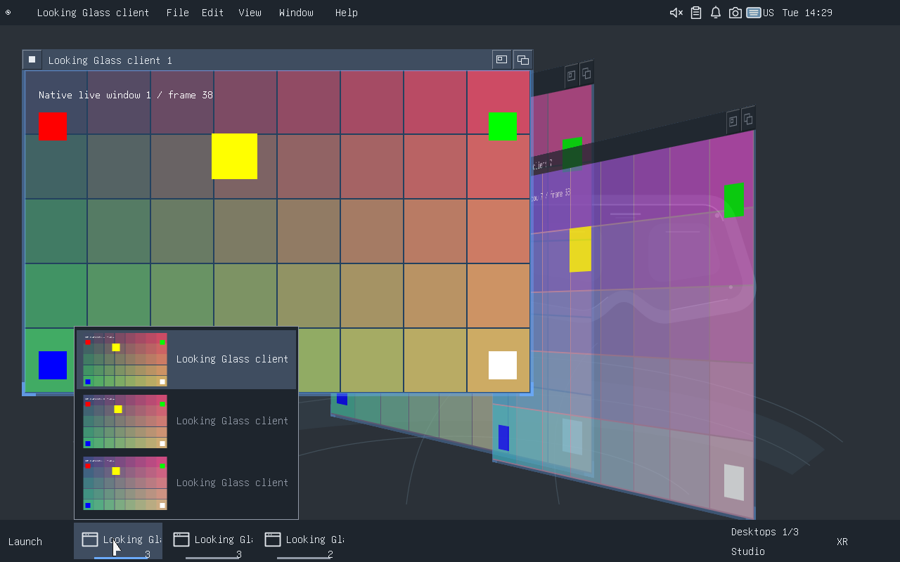

Looking Glass prototype, second iteration
========================================

This opt-in experiment tilts live application windows in their existing desktop
positions and dome locations. Client resolution, desktop rectangles, XR anchors
and scales are retained. Desktop presentation uses full-resolution GPU textures;
classic application-popup previews are separate. Tilted windows become progressively
transparent, reaching 65% opacity at 80 degrees. No separate overview grid,
window backs or note editor is presented.

The experiment lives on ``feat/looking-glass``. It starts from upstream DomeD
f797e0f, pulled before development, and retains the Orca sliced-object stereo
identity. Installed experimental builds start with Looking Glass disabled.
It uses the existing FLTK chrome and Cairo/FreeType text stack and adds no Qt
or GTK dependencies.

Controls
--------

* Window > Looking Glass Prototype (experimental), or Super+G, toggles the experiment.
* Super+scroll tilts the window under the pointer or XR ray, falling back to the
  focused window. Each wheel notch changes tilt by 10 degrees, bounded to
  -80 through +80 degrees. Super alone with scroll was previously unassigned;
  the binding is reserved only while the experiment is enabled.
* Clicking a tilted desktop window opens it flat and focuses it. That activation
  click is consumed. Application input resumes after it opens.
* Alt+Tab briefly brings each selected window 12 degrees toward the viewer.
  After switching stops for 900 ms, only the final focused window animates flat.
  Intermediate windows return to their chosen tilt. XR cycling preserves their
  dome locations rather than recentering them.
* The classic DomeD taskbar, desktop controls and application group popups are
  preserved. Looking Glass has no taskbar replacement or dedicated bar button.
* Super+G or the Window menu disables the experiment. Toggling off restores normal
  presentation; manual tilt state remains available during the same session.

Desktop and XR share tilt and focus state. XR uses rotated window quads and
matching ray intersections at the existing panel center and extent. Untilted XR
windows retain their original dome geometry. Notes and back-facing content are
not part of this iteration.

Screenshots
-----------

.. image:: looking-glass-desktop.png
   :alt: Full-resolution tilted desktop windows and the classic DomeD taskbar

.. image:: looking-glass-xr.png
   :alt: GPU-composed XR view of native window textures at their dome locations

Validation and limits
---------------------

``scripts/test-looking-glass.py`` launches eight animated native FLTK windows,
grouped into three applications, in a private nested compositor. It exercises
real desktop keys and wheel input, four-corner GPU visibility through both tilt
directions, unchanged classic taskbar pixels, geometry preservation, grouped
activation,
focus debounce, full-size texture transport, synthetic XR input and GPU XR
capture. Results are saved under ``artifacts/looking-glass-v2``::

    DOME_COMPOSITOR=/path/to/dome-compositor \
      uv run --no-project --with python-xlib --with pillow \
      python scripts/test-looking-glass.py

It requires Xvfb, python-xlib, Pillow, the installed FLTK toolkit and dome-capture.
Rust tests also check projection/inverse mapping, focus debounce, reversible
enabling and XR center/extent and ray-to-UV preservation. The committed validation
report records the latest completed run. Physical headset comfort and controller
ergonomics still require hardware testing.

Desktop snapshots have a 512 MiB cache budget and an 8192-pixel dimension limit.
If a full-resolution snapshot cannot be rendered, the compositor logs the failure
and displays the normal client surface. It does not reduce client resolution.
Desktop interaction with a tilted window begins by opening it flat. Freehand 3D
dragging and session-persistent tilt preferences are not implemented. Tilt is
limited to 80 degrees so windows retain a visible front surface.

Prepared binaries can be reviewed in a separate nested session. The existing
``scripts/install-looking-glass.py`` stages and installs verified binaries
without restarting the current session.
