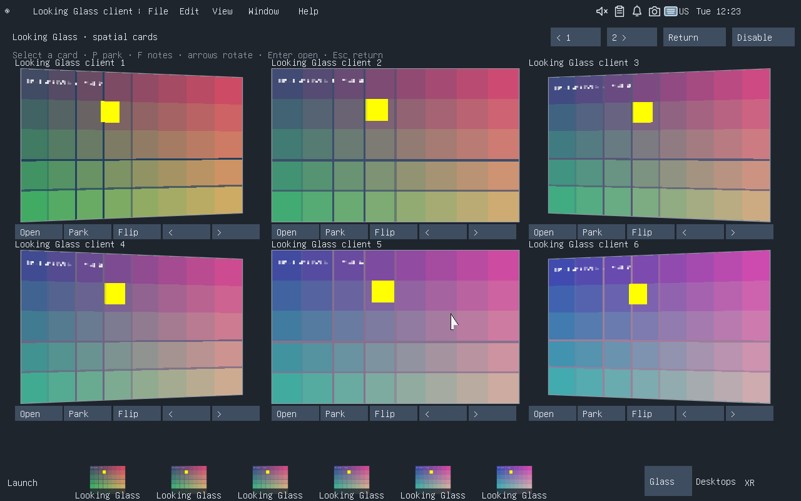
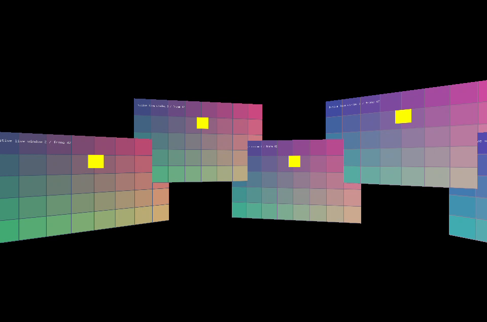

Looking Glass prototype
=======================

This opt-in compositor experiment is inspired by Sun's Project Looking Glass:
angled window cards, edge-on parking, notes on window backs and a reflective
window-preview taskbar. It uses existing native Wayland clients, FLTK chrome,
Cairo/FreeType bitmap text and DomeD's existing XR texture transport. It does not
embed Java3D or add Qt, GTK or scalable-font dependencies.

The implementation starts from upstream DomeD f797e0f, pulled before development,
and retains the Orca sliced-object stereo identity from the installed session.

Trying it
---------

After starting a session with the updated compositor and dome-xr helper:

* Choose Window > Looking Glass Prototype (experimental), or press Super+G.
* Each page contains at most six window cards. Use the page buttons for more.
* Select a card; P parks it edge-on, F opens its back and arrow keys rotate it.
* The card's Open, Park/Unpark, Flip and rotation buttons provide mouse/XR input.
* Type on the back to append a note. Backspace edits; newlines are supported.
* Open or Enter returns to the application. Escape/Return closes the overview.
* The reflective taskbar retains one preview per window on the current page.
  Clicking a preview opens that window; right-clicking opens its notes.
* The Glass taskbar button reopens the overview. The launcher and desktop
  switcher remain available. Disable returns to the standard shell.

Window identities and card metadata are shared by desktop and XR. In XR the
application surfaces are real flat quads with corresponding ray intersections,
anchored in the room by default; the normal head-anchor preference is respected.
The overview and note editor are compositor-owned XR panels, so they consume
input while open. A back-facing application's front is excluded from spatial
rendering; its notes appear in the overview instead of mirroring its contents.

Screenshots
-----------

Current limits
--------------

This is an experimental spatial switcher and taskbar, not a complete replacement
for normal application interaction. Desktop applications use their existing
rectangular client surfaces after leaving the projected card overview. XR keeps
actual spatial card geometry while the prototype is enabled. Animation and
freehand 3D dragging are not implemented. Preview refreshes are bounded and
rate-limited, not video-rate. Notes are session-local and do not survive a
compositor restart; the original client contents are never edited. Card state
is retained when disabling/re-enabling during the same session. Original desktop
rectangles and XR poses/scales are preserved when disabling the prototype.

Validation
----------

``scripts/test-looking-glass.py`` runs eight animated FLTK Wayland windows in a
private nested compositor, leaving the active desktop and headset alone. It
checks the real shortcut, controls, notes, page navigation, live preview pixels,
input isolation, synthetic XR seat input, XR quaternions, GPU texture composition
and restoration. It saves screenshots and a report in ``artifacts/looking-glass``.
It requires Xvfb, python-xlib, Pillow, the installed FLTK toolkit and dome-capture::

    DOME_COMPOSITOR=/path/to/dome-compositor \
      uv run --no-project --with python-xlib --with pillow \
      python scripts/test-looking-glass.py

The shared policy has Rust unit tests covering validation, reversible enable /
disable, bounded pages, projection hit tests and rotated ray-to-UV round trips.
Actual headset comfort, passthrough integration and controller ergonomics still
need hardware testing.

Background: the Project Looking Glass rotation/back-side interaction is described
in Columbia's 3D windows case study:
https://www.cs.columbia.edu/~feiner/courses/csw4172/classes/3Dwindows-25-2.pdf

Installing the prepared binaries
-------------------------------

After committing the tested source, prepare a stage from the release directory::

    python3 scripts/install-looking-glass.py --build /path/to/release
    python3 scripts/install-looking-glass.py --apply artifacts/looking-glass/install-plan.json --verify-only
    sudo -A python3 scripts/install-looking-glass.py --apply artifacts/looking-glass/install-plan.json

The installer verifies dependencies and hashes, backs up both existing compositor
and XR helpers, updates the suite inventory, and leaves running sessions alone.
The prototype starts disabled in a new session.
